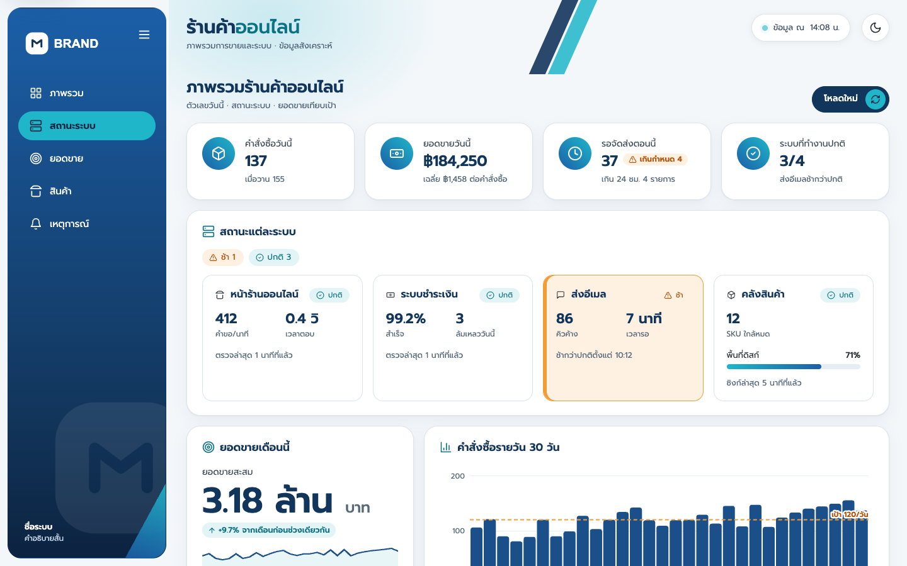
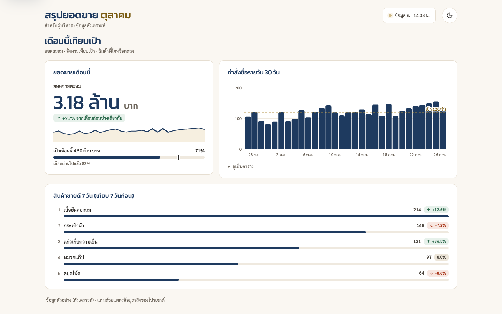
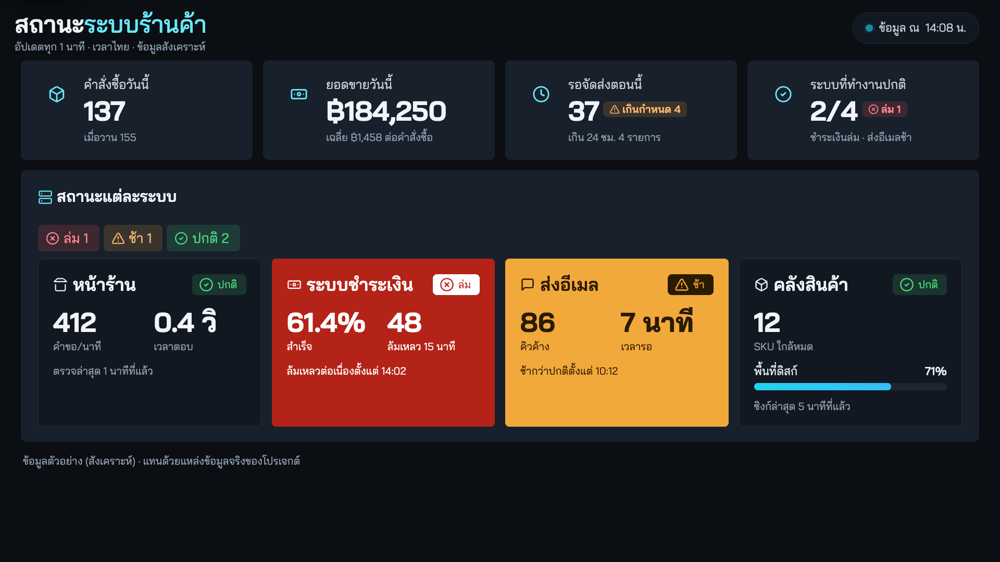
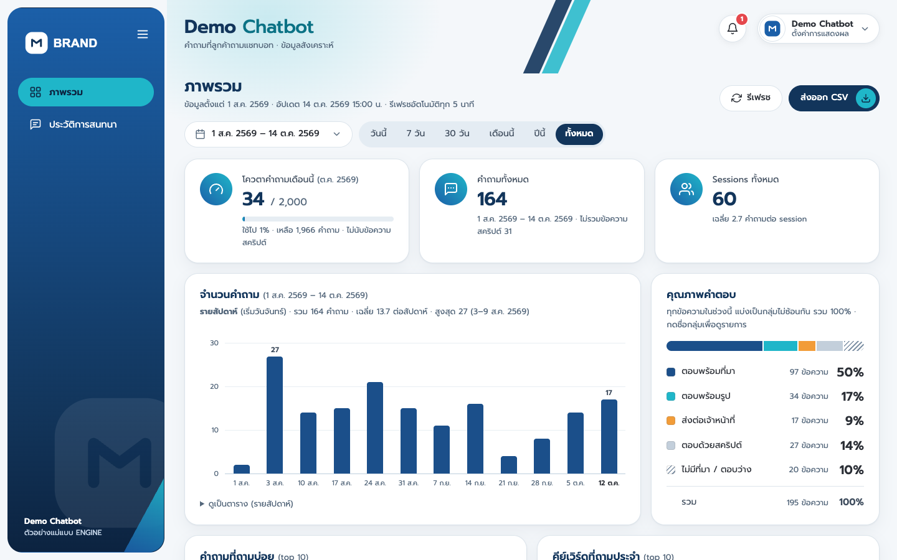
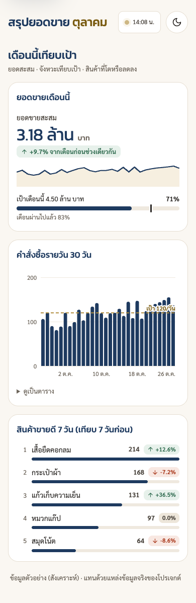

# build-dashboard

สกิลของ [Claude Code](https://claude.com/claude-code) สำหรับทำ dashboard ภาษาไทยที่ออกแบบจากความต้องการของงานนั้น ๆ
ใครดู ดูบนจออะไร ต้องเห็นอะไรก่อน และแบรนด์เป็นแบบไหน เป็นตัวกำหนดหน้าตา งานที่โจทย์ต่างกันจึงได้หน้าตาต่างกัน

*A Claude Code skill for building Thai-language dashboards whose look is designed from the brief: ops consoles, executive summaries, TV status walls, and admin dashboards over time-stamped records.*

<table>
  <tr>
    <td width="33%"></td>
    <td width="33%"></td>
    <td width="33%"></td>
  </tr>
  <tr>
    <td align="center">ทีมปฏิบัติการ เปิดทุกวันบนจอคอม</td>
    <td align="center">ผู้บริหาร ดูยอดเทียบเป้า</td>
    <td align="center">จอทีวีเปิดค้างในห้องทีม</td>
  </tr>
</table>

สามภาพนี้มาจากหน้าตั้งต้นไฟล์เดียวกัน (`design/page.html`) และข้อมูลชุดเดียวกัน ต่างกันแค่ตัวเลือกหน้าตาที่เลือกจากโจทย์ ทุกภาพใช้ข้อมูลสังเคราะห์

## ทำอะไรได้

- เขียน brief ก่อนลงมือ: ใครดู, ดูจากไหน, ต้องเห็นอะไรก่อน, อารมณ์หรือแบรนด์ แล้วให้ทุกการ์ดตอบคำถามใน brief ได้
- เลือกหน้าตาจาก brief: โครงหน้า (แถบเมนูข้าง, แถบบน, หน้าเดียว, จอทีวี, ฝังในแอป), ความแน่น, สไตล์การ์ด, ความมน, ฟอนต์ไทย และสี โดยมีสูตรอารมณ์ให้เริ่ม (ทางการพรีเมียม, ห้องควบคุมจอมืด, เป็นกันเอง, ทีมปฏิบัติการ)
- เวลาไทยและปี พ.ศ. ถูกต้องไม่ว่าเปิดจากโซนเวลาไหน, ตัวเลขเงินแบบ "3.18 ล้าน", ไอคอน SVG ไม่ใช้ emoji, โหมดมืดที่ออกแบบแยก ไม่ใช่กลับสี
- หน้าที่รีเฟรชเองบอกได้ว่าข้อมูลค้าง (ตัวเลขจางเป็นเทา มีแถบแดงบอกเวลาของข้อมูล และซ่อนคำสรุปว่า "ปกติ") จอทีวีจึงไม่ค้างที่สีเขียว
- จอทีวีออกแบบที่ 1920×1080 แล้วขยายตามจอตั้งแต่ 720p ถึง 4K ตัวอักษรเล็กสุดอ่านได้จากระยะ 3–4 เมตร
- มีเครื่องมือตรวจ: คอนทราสต์ของสีทั้งโหมดสว่างและมืด และตรวจหน้าทุกขนาดจอ (ไม่มี error, ไม่ล้นจอ, ไม่ล้นการ์ด)

## สองทาง

| ทาง | ใช้เมื่อ | เริ่มจาก |
|---|---|---|
| **1. ENGINE** | คนดูไล่ข้อมูลทีละแถว: ข้อมูลมีเวลาต่อแถว และต้องการตัวกรองช่วงเวลา ตารางค้นหา ส่งออก CSV หรือหน้ารายละเอียด เช่น log แชทบอท, คำสั่งซื้อ, ticket, log ของ API | `template/dashboard.html` แก้แค่ CONFIG, สี และโลโก้ |
| **2. ออกแบบเอง** | คนดูต้องการคำตอบ: สถานะสดของหลายระบบ, จอทีวี, สรุปผู้บริหาร/ลูกค้า, ข้อมูลจากหลายแหล่ง หรือหน้าที่ฝังในแอปเดิม | `design/page.html` + `ui.css` + `ui.js` |

ทั้งสองทางใช้ชุดดีไซน์เดียวกัน (`design/ui.css`) แก้หน้าตาที่เดียว มีผลทุกหน้า



*ทาง 1: แม่แบบ ENGINE กับ preset แชทบอท (ข้อมูลสังเคราะห์ในชุดเทสต์)*

## ตัวอย่าง: โจทย์ต่างกัน หน้าตาต่างกัน

<table>
  <tr>
    <td width="72%"></td>
    <td width="28%"></td>
  </tr>
</table>

**ผู้บริหาร ดูบนมือถือตอนเช้า "เดือนนี้จะถึงเป้าไหม"** → สูตรทางการพรีเมียม:
- หน้าเดียว ไม่มีเมนู ไม่มีปุ่ม แบนเนอร์เรียบ การ์ดเส้นขอบ
- ตัวเลขใหญ่น้ำหนักบาง หัวการ์ดไม่มีไอคอน สีทองใช้แค่เส้นเป้าและขีดบอกว่ากลางเดือนควรถึงกี่ %
- อันดับสินค้ามีป้ายบอกว่าโตหรือลดจากช่วงก่อน

**ทีมทั้งห้องเหลือบดูจอทีวีห่าง 3 เมตร "ระบบไหนล่ม"** → สูตรห้องควบคุมจอมืด (ภาพที่ 3 ด้านบน):
- ไม่มีเมนูและเคอร์เซอร์ ตัวอักษรใหญ่ ตัวที่ปกติเงียบ ตัวที่มีปัญหาเป็นสีทึบทั้งการ์ด
- แถวบนสรุปจำนวนแต่ละสถานะ และหายไปเมื่อข้อมูลค้าง

## ติดตั้ง

```bash
# ใช้ได้ทุกโปรเจกต์ในเครื่อง
git clone https://github.com/AbdarAwr/build-dashboard.git ~/.claude/skills/build-dashboard

# หรือใช้เฉพาะโปรเจกต์เดียว (แชร์กับทีมผ่าน repo ของโปรเจกต์)
git clone https://github.com/AbdarAwr/build-dashboard.git <โปรเจกต์>/.claude/skills/build-dashboard
```

เปิด session ใหม่ของ Claude Code แล้วสกิลจะขึ้นเอง อัปเดตด้วย `git -C ~/.claude/skills/build-dashboard pull`

**สิ่งที่ต้องมี**
- `python3` (ใช้แค่ไลบรารีมาตรฐาน) สำหรับ `design/sync.py` และ `design/check_tokens.py`
- เทสต์และตัวตรวจหน้า: `pip install pytest playwright` และ Google Chrome ในเครื่อง
- หน้า dashboard โหลดฟอนต์จาก Google Fonts จึงต้องต่อเน็ต

## ใช้งาน

พิมพ์ `/build-dashboard` หรือสั่งตามปกติ เช่น

- "ทำ dashboard ดู log แชทบอทให้ลูกค้าใหม่ CI สีเขียว"
- "ทำหน้าสถานะระบบทุกตัว ไว้เปิดค้างบนจอทีวีในห้องทีม"
- "ทำ dashboard ยอดขายให้ผู้บริหารลูกค้า ดูบนมือถือ ไม่ต้องเหมือน dashboard ของทีม"

Claude จะเขียน brief, เลือกทาง, เลือกหน้าตาตาม `reference/design.md`, ใส่ข้อมูล แล้วรันเทสต์และถ่ายภาพหน้าจอให้ตรวจก่อนส่ง

## ในโฟลเดอร์มีอะไร

| ไฟล์ | คืออะไร |
|---|---|
| `SKILL.md` | ขั้นตอนที่ Claude ทำตาม |
| `reference/design.md` | ออกแบบจาก brief: ตัวเลือกหน้าตา, สูตรอารมณ์, ชิ้นส่วนที่มี, สิ่งที่ต้องตรวจก่อนส่ง |
| `reference/layout.md`, `recipes.md`, `config.md` | เลือกและเรียงการ์ดของทาง ENGINE, สูตรตามชนิดข้อมูล, สัญญาของ CONFIG |
| `reference/branding.md`, `serving.md`, `chatbot-data.md` | ใส่ CI ของลูกค้า, ที่รันและหลังบ้าน, ข้อมูล log แชทบอท |
| `design/ui.css` | ชุดดีไซน์ (แหล่งเดียวของหน้าตา) |
| `design/ui.js` | ชิ้นส่วนของทาง 2: การ์ด, การ์ดสถานะ, หลอด, กราฟแท่ง/เส้น, อันดับ, ความสดของข้อมูล, โหมดจอทีวี, ตัวช่วยรวมยอด |
| `design/page.html` | หน้าตั้งต้นของทาง 2 |
| `design/sync.py` | ฝัง `ui.css` ลงแม่แบบ ENGINE |
| `design/check_tokens.py` | ตรวจคอนทราสต์ของสี |
| `template/` | แม่แบบ ENGINE: dashboard, หน้า login, โลโก้ placeholder |
| `tests/page_check.py` | ตรวจหน้าใดก็ได้ทุกขนาดจอและธีม |
| `tests/test_page.py` | เทสต์ตั้งต้นของโปรเจกต์ทาง 2 |
| `tests/test_template.py`, `tests/test_design.py` | เทสต์ของสกิล |

## เทสต์ของสกิล

```bash
cd ~/.claude/skills/build-dashboard
python3 design/sync.py --check                                        # ui.css กับแม่แบบตรงกัน
python3 -m pytest tests/test_design.py tests/test_template.py -q -p no:cacheprovider
```

เบราว์เซอร์ในเทสต์ตั้งโซนเวลาเป็น Los Angeles โดยตั้งใจ เพื่อพิสูจน์ว่าวันที่และเวลาบนหน้าคิดเป็นเวลาไทยเสมอ

## ข้อมูลเฉพาะของทีม

ข้อมูลที่ไม่ควรขึ้น repo (รายชื่อลูกค้า, endpoint จริง, ที่อยู่ไฟล์และวิธี deploy ของทีม) ให้เก็บใน `local/` ในโฟลเดอร์สกิล `.gitignore` กันไว้แล้ว และ `SKILL.md` บอกให้ Claude อ่าน `local/team-notes.md` ทุกครั้งถ้ามีไฟล์นี้
